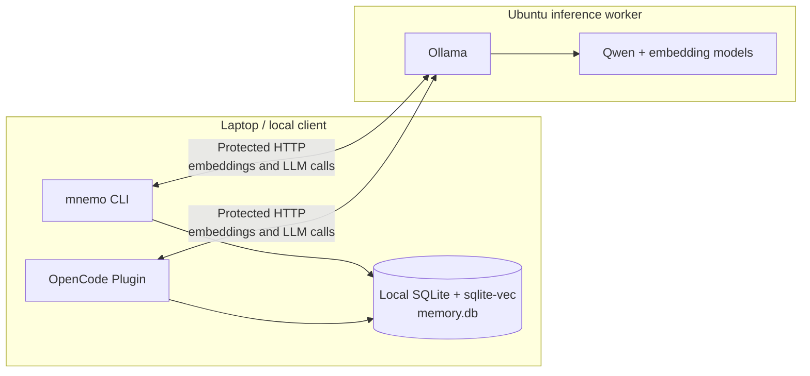
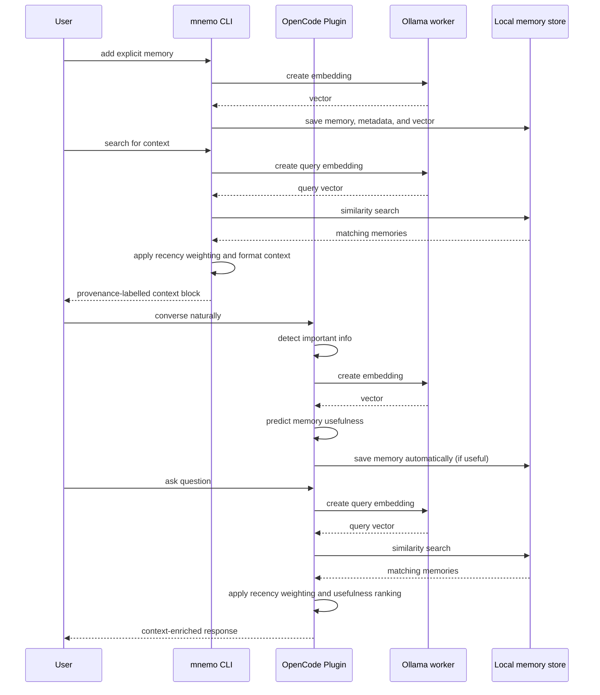
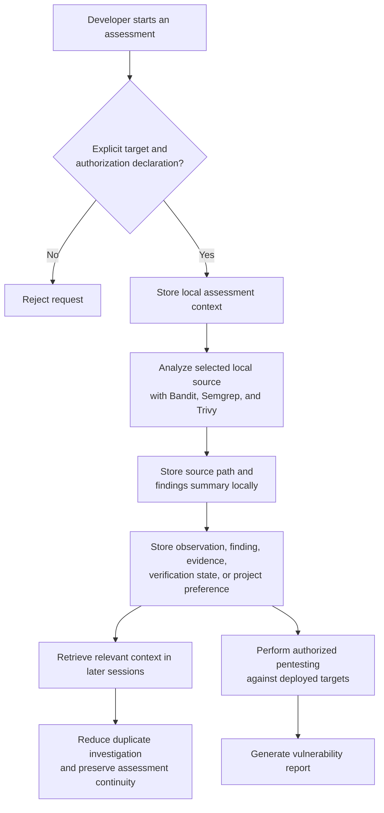

# Mnemosyne -- Current Architecture

Mnemosyne separates inference from memory ownership.

## Worker

The Ubuntu worker is only responsible for Ollama startup and model
provisioning; it does not install or run the Python client or demo. Ollama is
exposed on `0.0.0.0:11434` by default, so deploy it only on an appropriately
protected network. See the [setup and usage guide](usage.md) for provisioning,
listener configuration, readiness behavior, and model configuration.

## Local client

The laptop runs the CLI, creates embeddings through the worker, and owns the
SQLite database. `MNEMO_OLLAMA_URL` selects the worker; its default is
`http://localhost:11434`. `MNEMO_LLM_MODEL` and `MNEMO_EMBED_MODEL` default to
`qwen2.5:7b` and `nomic-embed-text`. CLI options override environment values.

The implemented operations are:

- `add`: embed and store an explicit memory locally.
- `search`: embed a query, use sqlite-vec similarity search, then apply
  recency weighting.
- `list`, `forget`, and `stats`: inspect or manage the local store.

`Memory` records content, type, trust label, source, timestamps, access count,
decay score, metadata, and its embedding. The store uses a metadata table plus
a sqlite-vec table, written together.

## Memory flows

### Store and retrieve context

### Authorized assessment memory

Assessment records are stored in the same local-memory model with an assessment
identifier and authorization metadata. The component records user-provided
context and can analyze a user-selected local source directory. It does not
scan targets, execute runtime tools, or exploit systems.

With the OpenCode plugin, Mnemosyne also provides pentest capabilities that can
perform authorized security testing against deployed applications based on
source code analysis.

### ML-Enhanced Memory Management

Mnemosyne plans to implement few-shot learning techniques to predict which retrieved memories are helpful.

The OpenCode plugin includes a framework for Qwen LLM integration to rate memories on a 1-5 scale based on:
- **Relevance** to the current context
- **Actionability** of the information
- **Specificity** of the details
- **Potential impact** on response quality

Low-rated memories would be automatically filtered out to prevent context pollution,
while high-rated memories would be prioritized in retrieval. This ML-enhanced
approach aims to improve the quality of context provided to the AI assistant.

## Scope and security status

This is an authorized security-assessment prototype, not a multi-tenant memory
service. There are no scopes/RBAC, automated extraction, deduplication,
conflict resolution, retention workflow, token budgeting, or target scanning.

Trust labels and sanitization/detection helpers exist, but the normal CLI
`add` path does not currently invoke sanitization. Consequently, stored memory
must not be represented as uniformly sanitized or trusted. Assessment tools
are useful for evaluating the prototype; they do not make the system a
complete security solution.
