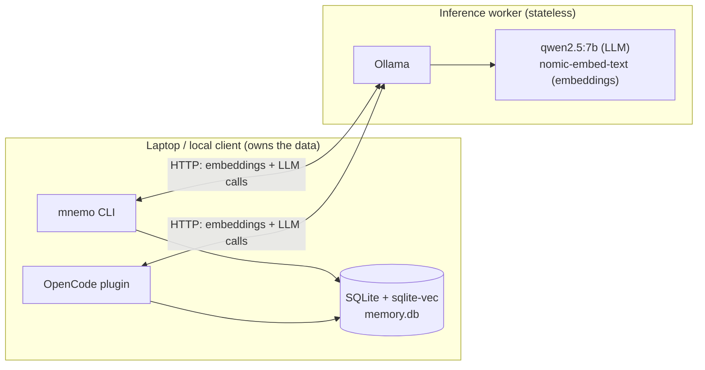
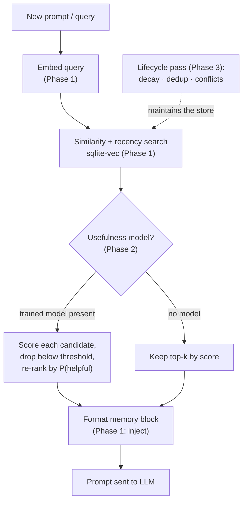
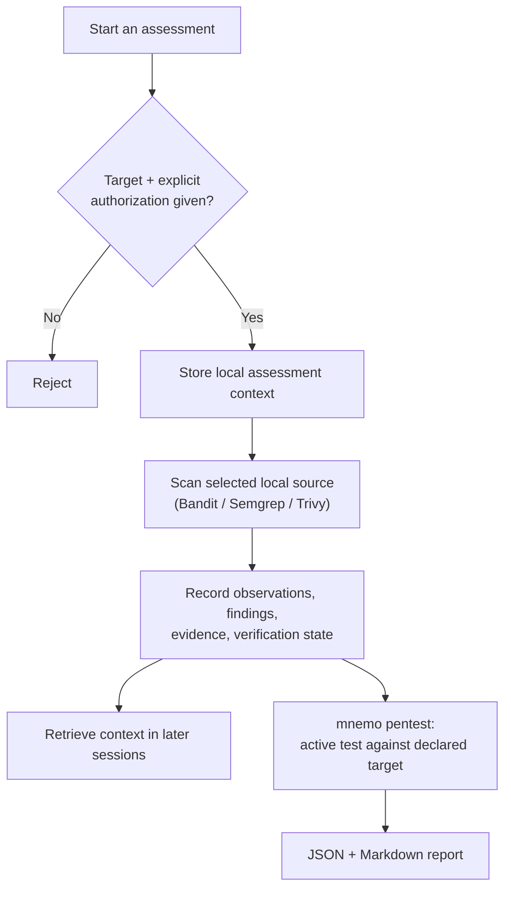
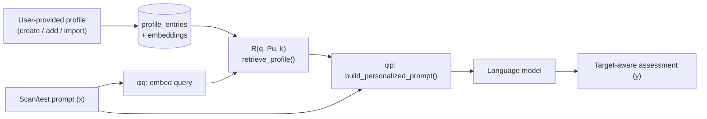

# Architecture

Mnemosyne is a **personalized context memory** system for AI assistants. It
stores interaction history as embeddings, retrieves the relevant memories for a
new prompt, uses a trained model to keep only the useful ones, and injects them
into the prompt — while keeping all memory data local to the user's machine.

The one design rule everything follows: **inference is remote, memory is
local.** A worker runs the models; your laptop owns the database.

The worker only runs Ollama and the models; it never sees the database. The
laptop creates embeddings through the worker and stores everything locally. See
[usage.md](usage.md) for how to provision each side.

## Components

| Area | Module | Responsibility |
|---|---|---|
| Core | `core/embeddings.py` | Turn text into vectors via the Ollama worker |
| Core | `core/store.py` | SQLite + `sqlite-vec` storage and similarity search |
| Core | `core/llm.py` | LLM calls to the worker (answers, optional classification) |
| Core | `core/types.py` | `Memory`, `MemoryQuery`, `MemoryResult`, enums |
| Retrieval | `ops/retrieve.py` | Similarity + recency ranking, optional model re-rank |
| Retrieval | `ops/inject.py` | Format the chosen memories into a prompt block |
| Profiles | `core/profiles.py` | User-provided **target-system profiles** (dedicated tables) |
| Profiles | `ops/retrieve.py` | `retrieve_profile()` — profile-scoped `R(q, Pu, k)` |
| Profiles | `ops/inject.py` | `build_personalized_prompt()` — combine prompt + profile (φp) |
| Selection | `eval/usefulness.py` | Trained model that predicts "is this memory helpful?" |
| Lifecycle | `lifecycle/manager.py` | Decay, deduplication, conflict/stale handling |
| Evaluation | `eval/benchmark.py`, `eval/dataset.py` | Ablation benchmark + synthetic data |
| Interface | `cli.py` | The `mnemo` command |
| Interface | `.opencode/` | OpenCode plugin + skills (see [plugin.md](plugin.md)) |
| Security | `security/` | Authorized assessment tooling (see [security.md](security.md)) |

## The memory record

Every memory is one `Memory` row (`core/types.py`):

| Field | Meaning |
|---|---|
| `content` | The remembered text |
| `memory_type` | `episodic`, `semantic`, or `procedural` |
| `trust_level` | `user_stated`, `agent_inferred`, `external_document`, `unknown` |
| `source` | Where it came from |
| `embedding` | The vector (stored in the `sqlite-vec` table) |
| `created_at` / `last_accessed` / `access_count` | Timing + usage, used for recency and decay |
| `decay_score` | Current relevance, recomputed by the lifecycle pass |
| `metadata` | Free-form extra fields |

## The memory pipeline

This is the core task, split across the project's four phases.

**Phase 1 — encoding, retrieval, injection.** `ops/retrieve.py` embeds the
query, runs a `sqlite-vec` similarity search, and blends in a recency score
(exponential decay of time since last access). `ops/inject.py` renders the
result as a provenance-labelled `## Remembered Context` block that is appended
to the prompt.

**Phase 2 — learned selection.** `eval/usefulness.py` trains a
logistic-regression classifier that predicts `P(helpful | query, memory)` from
three features: embedding similarity, recency, and trust level. When a trained
model is present, `retrieve()` scores each candidate, drops those below the
threshold, and re-ranks the rest. The model is stored as plain JSON (a weight
vector), so inference needs no scikit-learn. Train it with `mnemo
train-usefulness`.

> The feature set is deliberately small. An earlier 9-feature version learned a
> spurious negative weight on access count, so a memory stopped being injected
> after a few uses. See [evaluation.md](evaluation.md) for that analysis.

**Phase 3 — lifecycle.** `lifecycle/manager.py` keeps the store healthy
(`mnemo lifecycle`):

- **Decay** — recompute `decay_score` as exponential decay since last access; optionally prune the faded ones.
- **Deduplication** — cluster near-identical embeddings (cosine above a threshold) so duplicates can be merged.
- **Conflicts / stale facts** — flag near-duplicate memories that disagree (negation cues, or same subject with a different value) and mark the older one stale.

**Phase 4 — impact analysis.** `eval/benchmark.py` runs the whole pipeline
under several configurations (no-memory / memory-only / +selection /
+lifecycle) and reports QA F1, Recall@k, and a **stale-bias rate** — a direct
measure of when memory *helps* versus when it *introduces bias*. Full results
are in [evaluation.md](evaluation.md).

## CLI surface

`mnemo` exposes the pipeline end to end:

| Group | Commands |
|---|---|
| Memory | `add`, `search`, `list`, `forget`, `stats`, `context`, `score` |
| Profiles | `profile create/add/import/show/list/forget` |
| Selection (Phase 2) | `generate-dataset`, `label-usefulness`, `train-usefulness` |
| Lifecycle (Phase 3) | `lifecycle` |
| Evaluation (Phase 4) | `benchmark` |
| Assessment (security) | `assess create/record/preference/source-scan/run/list`, `scan`, `redteam`, `pentest`, `tools list/run` |

Run `mnemo --help` for options. Normal memory commands use
`~/.local/share/mnemo/memory.db` by default; `--db` selects another local path.

## Assessment subsystem

Mnemosyne also ships an **authorized security-assessment** toolset that reuses
the same local-memory model to retain engagement context across sessions. It is
summarized here and documented in full in [security.md](security.md).

## Target profiles — personalization for assessment

The profile subsystem applies the LaMP retrieval-augmentation design
([Salemi et al., 2023](https://arxiv.org/abs/2304.11406)) to security
assessment. In LaMP, a model is personalized by retrieving relevant items from a
**user profile** and injecting them into the prompt rather than conditioning on
the whole profile. Here the "user profile" is a **target-system profile**: a
user-provided collection of entries describing a target (stack, endpoints, auth
model, constraints, prior findings).

| LaMP | Mnemosyne | Where |
|---|---|---|
| User profile `Pu = {(x,y)…}` | `TargetProfile` + `ProfileEntry` (dedicated tables) | `core/profiles.py` |
| Input `x` / query `φq` | The scan/test prompt (also the retrieval query) | `cli.py: assess run` |
| Retrieval `R(q, Pu, k)` | `retrieve_profile()` — similarity + recency + usefulness, scoped to one profile | `ops/retrieve.py` |
| Prompt construction `φp` | `build_personalized_prompt()` | `ops/inject.py` |
| Language model → output `y` | Ollama LLM call | `core/llm.py` |

The profile is **saved/provided by the user** (`mnemo profile create/add/import`)
and lives in dedicated `profiles` / `profile_entries` tables alongside the memory
store, keeping the local-first invariant. When a scan/test runs
(`mnemo assess run --profile <id> --prompt "<task>"`), the prompt is combined
with the retrieved profile entries (In-Prompt Augmentation) and sent to the model
for a **target-aware** assessment.

## Scope and honest limitations

Mnemosyne is a research prototype, not a multi-tenant memory service. What that
means in practice:

- **No scopes / RBAC.** The authorization declaration on an assessment is an
  audit note, not access control or proof an engagement is approved.
- **`mnemo add` does not sanitize.** Explicit CLI input is written to the store
  as-is; the sanitization and detection helpers exist but are not on the plain
  `add` path. Treat stored memory as untrusted context. (The plugin's automatic
  capture is an exception: it uses `mnemo add --sanitize`, which rejects
  injection and secret-bearing content before storing.)
- **Lifecycle runs on demand, and automatically from the plugin.** Decay, dedup,
  and conflict resolution are implemented in `mnemo lifecycle`. The CLI runs them
  when invoked; the OpenCode plugin now also triggers a debounced, rate-limited
  `mnemo lifecycle --resolve-conflicts` after auto-capture (configurable via
  `MNEMO_LIFECYCLE_*`). Aggressive pruning is still opt-in.
- **Selection labels are synthetic.** The Phase 2 model is trained on a
  deterministic labeler; real labels (e.g. "the memory was actually cited")
  are the intended source but are not wired in yet.
