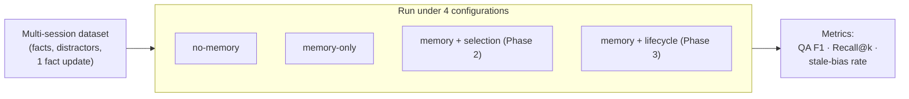

# Mnemosyne -- Evaluation Plan

## Benchmarks

### LoCoMo (Long-Context Conversation Memory)

Very long multi-session conversations (~300 turns, up to 35 sessions). Tasks include QA, event summarization, and multimodal dialogue. Tests whether the system can retrieve and reason over information from much earlier in a conversation history. Mem0 reports 92.5% on this benchmark.

Reference: Maharana et al. (2024), arXiv:2402.17753.

### LongMemEval

500 questions testing five specific memory abilities: information extraction, multi-session reasoning, temporal reasoning, knowledge updates, and abstention (knowing when it does not have the answer). Commercial assistants show ~30% performance drop across sessions, making this a good test of memory system effectiveness.

Reference: Wu et al. (2024), ICLR 2025, arXiv:2410.10813.

### MSC (Multi-Session Chat)

Human-human multi-session conversation dataset. The standard "does it remember prior sessions" test. Useful as a baseline and for measuring conversational coherence with memory augmentation.

Reference: Xu, Szlam, Weston (2021), arXiv:2107.07567.

### PerLTQA

8,593 QA pairs over 30 synthetic personas, combining episodic and semantic personal memory. Tests both factual recall and the ability to reason over personal history.

Reference: Du et al. (2024), arXiv:2402.16288.

## Metrics

### Retrieval quality

- **Recall@k.** Was the correct memory in the top-k retrieved results? Measured at k=1, 3, 5, 10. The primary retrieval metric.
- **Precision@k.** What fraction of the top-k results were relevant? Important for measuring noise in retrieval.
- **MRR (Mean Reciprocal Rank).** Average of 1/rank-of-first-relevant-result across queries.

### End-to-end quality

- **QA accuracy / F1.** On benchmark question-answer pairs, does the memory-augmented system produce correct answers? Compared against no-memory baseline.
- **Personalization quality.** LLM-as-judge evaluation: given a user profile and a response, does the response appropriately use personal context? Scored on a 1-5 scale.
- **Memory accuracy.** Do the stored memories accurately reflect the source material? Measured by sampling memories and comparing to source conversations.

### Efficiency

- **Latency.** End-to-end time from query to response, broken down by: embedding (ms), retrieval (ms), LLM generation (ms).
- **Token cost.** How many tokens does the memory block add to each prompt? Measured as absolute count and as a fraction of the context window.
- **Storage size.** Database size on disk as a function of number of memories.

### Security metrics

- **Attack success rate (ASR).** Fraction of red-team payloads that survive sanitization and enter the store. Target: < 10%.
- **Defense effectiveness.** 1 - ASR. Target: > 90%.
- **False positive rate (FPR).** Fraction of legitimate memories incorrectly blocked by the sanitization pipeline. Target: < 5%.
- **Poisoning impact.** When a poisoned memory does enter the store, how often does it alter the LLM's response compared to the non-poisoned baseline?
- **Detection latency.** How quickly are poisoned memories detected by the post-storage heuristics?

## Ablation study design

The ablation study is implemented in `src/mnemo/eval/benchmark.py` and run via
`mnemo benchmark` / `make benchmark`. It isolates the contribution of each
system component by running the benchmark suite under different
configurations:

Each configuration toggles one capability so its contribution shows up in the
metrics — most importantly the **stale-bias rate**, which answers Phase 4's
question of when memory helps versus when it introduces bias.

| Configuration | Memory | Selection model | Lifecycle | Purpose |
|---------------|--------|----------------|-----------|---------|
| no-memory | OFF | OFF | OFF | LLM with no memory augmentation |
| memory-only | ON | OFF | OFF | Raw retrieval without learned ranking |
| memory+selection | ON | ON | OFF | Full retrieval with usefulness prediction |
| memory+lifecycle | ON | OFF | ON | Conflict resolution before answering |

For each configuration, the harness measures per QA pair:
- **QA F1** (token-level, SQuAD-style) against the gold answer.
- **Retrieval Recall@k** against the gold fact (memory configurations).
- **Stale-bias rate**: fraction of update-queries answered with the superseded
  value — the direct memory-induced-bias signal.

The LLM is run at temperature 0 so results are reproducible run-to-run.

Memories are inserted with the timestamps of the session that stated them:
session-1 facts (including the one later superseded) are 45 days old and the
session-3 update is fresh. Benchmark retrieval does not `touch()` memories, so
one question cannot refresh the recency features seen by the next. This keeps
the features the selection model was trained on meaningful at benchmark time.
Trust is `user_stated` for every fact because the user stated all of them.

Latest run (synthetic 10-conversation dataset: 80 questions, 10 of them
update-queries; qwen2.5:7b + nomic-embed-text; usefulness model retrained on
the same 10 conversations; in `data/benchmark-report.json`):

| Configuration | Mean F1 | Recall@5 | Stale-bias rate |
|---|---|---|---|
| no-memory | 0.091 | — | — (3/10 by chance) |
| memory-only | 0.599 | 1.00 | 1.00 (10/10) |
| memory+selection | 0.575 | 1.00 | 1.00 (10/10) |
| memory+lifecycle | **0.652** | 1.00 | **0.00** (0/10) |

Reading the table:
- Memory helps: 6.6× F1 over the stateless baseline (memory-only).
- **Memory induces bias**: without lifecycle management, every update-query
  answer contains the superseded value ("You use VS Code and Neovim",
  "You live in Bucharest"). Both facts are retrieved with the same
  `[semantic|user_stated]` tag and no date, so the LLM cannot tell which is
  current. For reference, the no-memory baseline names the old value in 3/10
  answers just by guessing (e.g. "Python" for a language question), so the
  memory-only rate is well above chance.
- **Phase 3 → Phase 4**: running conflict resolution (`memory+lifecycle`)
  eliminates stale bias (1.00 → 0.00) *and* improves F1 (0.599 → 0.652).
- **The Phase 2 selection model does not mitigate stale bias.** It keeps every
  gold fact (recall 1.00) and filters some distractors, but F1 is slightly
  lower than memory-only (0.575 vs 0.599) and every update answer still
  contains the old value. The learned recency weight is ≈0 (−0.13): in the
  labeler, age only marks the one stale fact per conversation, which is too
  little signal. Trust does carry weight (`user_stated` +0.70,
  `agent_inferred` −0.58), but every benchmark fact is `user_stated`, so it
  cannot help here. Similarity dominates (+24.7).
- **Feature set**: the model trains on similarity, recency and trust only.
  An earlier 9-feature version also used access count, decay and memory type,
  which the labeler assigns at random. It learned a spurious negative
  access-count weight (−1.79), and because every retrieval increments the
  count, a relevant memory fell below the threshold after 3 uses. This was
  observed in a live OpenCode session (see `docs/plugin.md`). In the
  benchmark, that model dropped valid old facts (recall 0.79, F1 0.514).
- **Similarity alone still beats the model.** Stratified 5-fold CV F1 on
  the 670 labeled examples (71 positive):

  | Features | CV F1 |
  |---|---|
  | similarity + recency + trust (current model) | 0.847 ± 0.026 |
  | all 9 (previous model) | 0.835 ± 0.054 |
  | similarity only | **0.884 ± 0.033** |
  | similarity + trust | 0.829 ± 0.042 |

  A linear model cannot express the labeler's real rule ("agent_inferred
  *and* relevant ⇒ often wrong"); an interaction feature would be needed.
- **Similarity feature**: `store.search` returns `1 − L2 distance` (sqlite-vec's
  default metric), not cosine. For unit-length embeddings this ranks memories
  the same way as cosine, and training and serving use the same value, but the
  absolute numbers (≈ −0.1 to 0.4) are not cosine similarities.
- **Circularity caveat**: the labeler was written so that trust and recency
  correlate with helpfulness (agent_inferred memories are wrong 60% of the
  time; the stale fact is old). A model that learns those features shows the
  training method works, not that those features predict usefulness in real
  usage. That requires labels from logged real sessions.
- **Sample size**: 10 update-queries is still small. One more or one fewer
  stale answer moves a rate by 0.10.

### opencode-bench (not yet run)

[opencode-bench](https://github.com/anomalyco/opencode-bench) is **not** a
memory benchmark. It runs a coding agent on real GitHub commits and has three
LLM judges score the diff (API signature, logic equivalence, integration
points, test coverage, project checks). Its tasks cannot be converted into
this harness's multi-session QA format.

The validation that fits it is an A/B run: the same tasks and model with the
Mnemosyne plugin off vs. on, with memory seeded beforehand with the repository's
conventions. The runner, seed memories and instructions are in
`bench/opencode-bench/`. **No results exist yet.**

`mnemo benchmark --dataset` accepts other multi-session QA datasets with the
same schema (e.g. a LoCoMo or LongMemEval subset converted to this format).

### Security ablation

The current red-team harness (`mnemo redteam` / `make redteam`) uses the regex
sanitizer in `sanitize()` before storage and defaults to its isolated
`redteam-assessment.db` store rather than the normal memory database. It does
not yet run LLM classification or post-storage detection.

| Configuration | Command | What it tests |
|---------------|---------|---------------|
| Current campaign | `mnemo redteam` | Regex sanitizer effectiveness |
| Planned manual ablation | Bypass `sanitize()` in `run_attack()` | No-sanitization baseline |
| Planned manual ablation | LLM classifier | Classifier contribution |
| Planned manual ablation | Post-storage `detect_suspicious()` | Detection after storage |

`mnemo scan` / `make scan` invokes Bandit, Semgrep, and Trivy when present. Client
dependencies include Bandit (the `security` extra), but not Semgrep or Trivy.

This isolates the contribution of each defense layer.

## Bias analysis

Memory augmentation can introduce bias in several ways:

### Stale context

A memory stores "user is a junior developer" but the user has since gained experience. The system provides oversimplified explanations. **Implemented**: the benchmark's stale-bias rate measures exactly this (update-queries answered with the superseded fact), and `mnemo lifecycle` mitigates it via decay + conflict resolution.

### Confirmation bias

The system retrieves memories that confirm the LLM's prior assumptions rather than challenging them. Measured by: diversity of retrieved memory types and trust levels across queries.

### Adversarial drift

Poisoned memories gradually shift the system's behavior in a specific direction, too subtle to detect in any single interaction. Measured by: behavioral consistency scores (LLM-as-judge) over a sequence of 50+ interactions with and without adversarial memories present.

### Over-personalization

The system over-indexes on personal context and fails to provide objective information when appropriate. Measured by: accuracy on factual questions where personal memory is irrelevant (the system should not inject personal context when it does not help).

## Evaluation timeline

| Phase | When | What |
|-------|------|------|
| Retrieval baselines | Phase 1 (Oct 2026) | Recall@k and MRR on synthetic data with known-relevant memories |
| Selection model eval | Phase 2 (Nov 2026) | A/B comparison of retrieval with and without usefulness prediction |
| Security eval | Phase 3 (Dec 2026) | Red-team harness: ASR, defense effectiveness, FPR |
| Full benchmark run | Phase 4 (Jan 2027) | LoCoMo and/or LongMemEval subsets, ablation study, bias analysis |
| Final report | Phase 4 (Jan 2027) | All metrics compiled, compared to existing plugin baselines |
