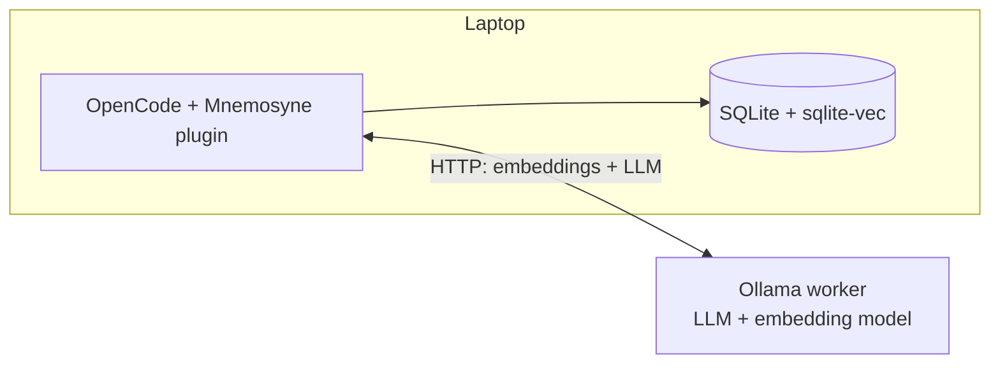
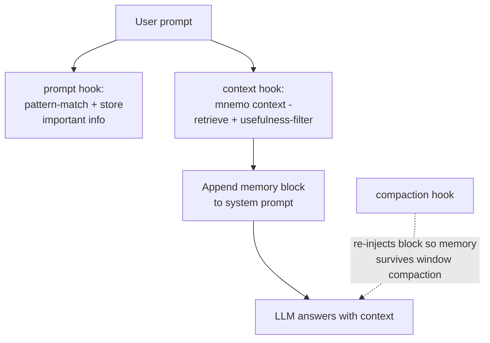

# Mnemosyne OpenCode Plugin

> ⚠️ **Educational Purpose Only**: This plugin is designed for educational and research purposes only. It demonstrates concepts related to AI assistant memory management and security assessment techniques. Any security testing capabilities should only be used in controlled environments with explicit authorization.

A security-focused personalized context memory plugin for OpenCode that extends AI assistants with persistent memory capabilities and pentesting tools.

## Features

- **Persistent Memory**: Store and retrieve memories with trust levels and metadata
- **Security Assessment**: Analyze source code and perform pentesting against deployed targets
- **Integration**: Seamlessly integrates with OpenCode's AI assistant workflows

## Installation

### OpenCode 2.x

The OpenCode 2 plugin lives at:

```text
.opencode/plugins/mnemosyne/index.js
```

OpenCode 2 automatically loads plugins under `.opencode/plugins/` for this
repository. To use it from another project, either copy the plugin directory:

```bash
mkdir -p /path/to/project/.opencode/plugins
cp -R /path/to/mnemosyne/.opencode/plugins/mnemosyne \
  /path/to/project/.opencode/plugins/
```

or reference this repo's plugin from that project's `opencode.jsonc`:

```jsonc
{
  "$schema": "https://opencode.ai/config.json",
  "plugins": [
    "/path/to/mnemosyne/.opencode/plugins/mnemosyne"
  ]
}
```

Run `npm install` in this repository first so `@opencode/plugin` resolves.

### Claude Code

Mnemosyne also ships a Claude Code plugin under `claudecode-plugin/`. It gives
Claude Code the same capabilities through a `UserPromptSubmit` hook (automatic
memory capture and context injection) and `/mnemosyne:*` slash commands
(`remember`, `recall`, `scan`, `assess-create`, `assess-record`, `pentest`,
`security-tools-list`, `security-tool-run`). The hook runs `mnemo
claudecode-hook`, which reuses the same `mnemo add`/`mnemo context` pipeline as
the OpenCode plugins. See
[claudecode-plugin/README.md](../claudecode-plugin/README.md) for installation
and usage.

### Legacy OpenCode 1.x

The old OpenCode 1 plugin remains available as `opencode-plugin.js`. Load it
from an OpenCode 1.x config only:

```json
{
  "$schema": "https://opencode.ai/config.json",
  "plugin": ["file:///absolute/path/to/mnemosyne/opencode-plugin.js"]
}
```

Run `npm install` in this repository first so `@opencode-ai/plugin` resolves.

### Environment

| Variable | Purpose | Default |
|---|---|---|
| `MNEMO_BIN` | `mnemo` executable the plugin runs (e.g. `<repo>/.venv/bin/mnemo`) | `python3 -m mnemo.cli` |
| `MNEMO_DB` | Memory database used by every `mnemo` command | `~/.local/share/mnemo/memory.db` |
| `MNEMO_USEFULNESS_MODEL` | Phase 2 model file | `~/.local/share/mnemo/usefulness-model.json` |

Set `MNEMO_BIN` unless `mnemo` is importable by the system `python3` from the
session's directory; otherwise every hook call fails (logged as a warning).

## Usage

Once installed, the plugin works automatically in the background, but also provides manual tools when needed:

### Automatic Memory Management

Mnemosyne automatically:
- **Stores** important user preferences and project information from conversations
- **Retrieves** relevant context memories when the AI responds
- **Maintains** a personalized knowledge base with minimal configuration

### Manual Tools

In OpenCode 2, tools are namespaced to avoid collisions. The effective tool
names are prefixed with `mnemo_` (for example, `mnemo_remember`). In legacy
OpenCode 1, the same tools were exposed without the prefix.

You can also manually control memory operations:

#### `mnemo_assessCreate` - Authorized Assessment Context

Create an authorization record before active testing:

```
> mnemo_assessCreate --assessmentId web-lab --target https://app.example.com --authorized "Approved under ticket SEC-123"
```

#### `mnemo_assessRecord` - Assessment Evidence Notes

Record observations or findings under an assessment:

```
> mnemo_assessRecord --assessmentId web-lab --content "Observed missing rate limit" --kind finding --severity medium
```

#### `mnemo_pentest` - Security Pentesting

Analyze source code and perform active pentesting against deployed applications.
This requires an existing authorized assessment:

```
> mnemo_pentest --assessmentId web-lab --sourcePath ./my-app --targetUrl https://my-app.example.com
```

#### `mnemo_scan` - Source Code Scanning

Scan source code for security vulnerabilities using Bandit, Semgrep, and Trivy:

```
> mnemo_scan --projectPath ./my-project
```

#### `mnemo_securityToolsList` - Registered Security Tools

List the Mnemo tool registry or a specific category:

```
> mnemo_securityToolsList
> mnemo_securityToolsList --category web-scan
```

#### `mnemo_securityToolRun` - Docker/Kali Tool Runner

Run a registered tool locally or through a Docker/Kali image:

```
> mnemo_securityToolRun --toolName nmap --authorization "Approved under ticket SEC-123" --args "-sV app.example.com"
> mnemo_securityToolRun --toolName bandit --mode local --args "-r src"
```

#### `mnemo_remember` - Manual Memory Storage

Manually store contextual information (automatic by default):

```
> mnemo_remember --content "User prefers Python for backend development"
```

#### `mnemo_recall` - Manual Memory Retrieval

Manually search for memories (automatic by default):

```
> mnemo_recall --query "What programming language does the user prefer?" --topK 3
```

## Skills

This repository also ships OpenCode skill instructions under `.opencode/skill/`:

| Skill | Purpose |
|---|---|
| `mnemo-memory` | Remembering, recalling, context injection, and memory hygiene |
| `mnemo-security-assessment` | Authorized assessment records, source scans, and scoped pentest workflow |
| `mnemo-docker-kali-tools` | Listing/running registered local or Docker/Kali security tools |

These skills complement the plugin. The plugin provides executable tools and
hooks; the skills provide workflow instructions and safety guardrails for agents
that support OpenCode skills.

## Architecture

Mnemosyne separates inference from memory ownership (full detail in
[architecture.md](architecture.md)):



## Memory Management

Mnemosyne stores memories automatically from conversations (pattern-matched user
preferences, project conventions, etc.) and injects the relevant ones into the
prompt on every turn:




1. The OpenCode 2 `session.hook("prompt")` hook captures the current user
   prompt and stores pattern-matched important information.
2. The OpenCode 2 `session.hook("context")` hook runs `mnemo context <message>`
   — which retrieves, usefulness-filters (trained Phase 2 model), and formats
   the top memories — and appends the result to the system prompt.
3. The OpenCode 2 `session.hook("compaction")` hook also injects the memory block
   into the compaction prompt so context survives window compaction.

The legacy OpenCode 1 plugin uses `chat.message`,
`experimental.chat.system.transform`, and `experimental.session.compacting` for
similar behavior.

The Phase 2 usefulness model (`mnemo train-usefulness`) is a logistic-regression
classifier over (query, memory) features (embedding similarity, recency, trust
level) that filters noise out of retrieval. It deliberately does not use
access count: an earlier version learned a spurious negative weight on it, and
since every retrieval increments the count, a relevant memory stopped being
injected after 3 uses. The live session below caught this.

Auto-capture is regex-based (`extractImportantInfo`): only user messages
matching phrases such as "user prefers" or "remember … for later" are stored
automatically. Use the `remember` tool to store anything else. Lifecycle
maintenance (`mnemo lifecycle`) is not run by the plugin; run it manually.

## Live session evidence

`bench/live-session/run.sh` runs OpenCode 1.18.34 headless (`opencode run`)
against local Ollama (`qwen2.5:7b` with a 16k context) in an isolated temp
config. It seeds two memories, asks two questions in one session with the
plugin on, then asks the first question again with the plugin off. Logs are in
`bench/live-session/logs/`. Excerpt from the latest run:

```text
# turn 1, plugin on
INFO message="Mnemosyne plugin initialized"
INFO message="Injected 1 memories into system prompt" query="Which database do we run in production, and in which AWS region? ..."
> Our production database runs on PostgreSQL 16 in the eu-west-1 region of AWS.

# turn 2 (--continue), plugin on
INFO message="Injected 1 memories into system prompt" query="Which tools do I prefer for testing and linting? ..."
> You prefer pytest for testing and ruff for linting.

# control, plugin off (same question as turn 1)
> The production database is PostgreSQL running in the us-east-1 AWS region.
```

Without memory the model guesses a common default (PostgreSQL) and the wrong
region; with the plugin it gives the stored version and region.

## Security Model

Mnemosyne is designed for authorized security assessments:

- **Trust Labels**: Classify memories by trust level (`user_stated`, `agent_inferred`, etc.)
- **Sanitization**: Regex-based content filtering before storage
- **Anomaly Detection**: Identify suspicious memory patterns
- **Authorized Use**: All security testing requires explicit authorization

## Requirements

- OpenCode 2.x for `.opencode/plugins/mnemosyne/index.js`
- OpenCode 1.x only for the legacy `opencode-plugin.js`
- Python 3.11+
- Ollama with `qwen2.5:7b` and `nomic-embed-text` models
- Node.js 18+ (for plugin dependencies)

## Development

To develop the plugin locally:

1. Clone this repository
2. Install dependencies: `npm install`
3. Run the hook tests: `npm run test:plugin` (covers OpenCode 2 plugin
   registration/hooks and the legacy OpenCode 1 plugin wrapper)
4. Optionally run `bench/live-session/run.sh` for the legacy OpenCode 1
   end-to-end benchmark.

## License

MIT
