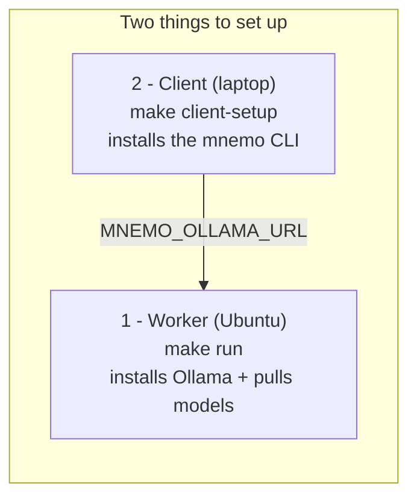

# Setup and usage

Mnemosyne separates an Ubuntu Ollama inference worker from the laptop that
owns the local memory database. This page describes how to provision each side
and use the CLI. For the deployment rationale, see the
[architecture overview](architecture.md).



The worker runs the models; the client runs the CLI and owns the database. You
set up each side once, then point the client at the worker with
`MNEMO_OLLAMA_URL`.

## Recommended setup

**Reference machine: a MacBook Pro M1 (16 GB) or equivalent.** Apple Silicon
runs Ollama with Metal GPU acceleration, so on an M1-class laptop you can run
**everything locally** — embeddings, retrieval, the Phase 2 selection model, the
Phase 3 lifecycle, *and* the LLM — with no separate worker. The two-worker split
above is for when the host is too weak to run the LLM (e.g. a CPU box without
AVX); on an M1 you can collapse it to a single machine pointed at `localhost`.

### Recommended models

| Role | Model | Notes |
|---|---|---|
| Embeddings | **`nomic-embed-text`** | ~140M params, near-instant on Metal, 768-dim (matches the store's default). |
| LLM | **`qwen2.5:7b-instruct`** | ~4.7 GB at Q4; mnemo's LLM work is short-answer QA + classification, not coding, so 7B is the sweet spot. |

These are the project defaults — keep them unless you have a reason to change.

### Pick the LLM for your unified memory

| Unified memory | LLM | Why |
|---|---|---|
| 8 GB | `qwen2.5:3b` (or `1.5b`) | 7B swaps and crawls at 8 GB. |
| **16 GB (recommended)** | **`qwen2.5:7b-instruct`** | Comfortable with Metal; the target config. |
| 32 GB+ (M1 Pro/Max) | `qwen2.5:14b` optional | Sharper answers, but 7B is plenty for mnemo. |

> Upgrading the **embedding** model (e.g. to `bge-m3` or `mxbai-embed-large`,
> 1024-dim) changes the vector dimension, so you must set
> `MemoryStore(dimensions=1024)` and rebuild the DB (`make clean`). Only worth it
> if retrieval recall is actually limiting you.

### Run it all locally on Apple Silicon

```bash
ollama pull nomic-embed-text
ollama pull qwen2.5:7b
export MNEMO_OLLAMA_URL=http://localhost:11434
export MNEMO_EMBED_MODEL=nomic-embed-text
export MNEMO_LLM_MODEL=qwen2.5:7b
make client-setup
make demo
```

If instead you are running the LLM on a separate host (CPU box, remote worker),
follow the two-step worker/client setup below.

## 1. Provision the Ubuntu inference worker

On the Ubuntu container or host that will run Ollama, clone the repository and
run:

```bash
make run
```

This installs Ollama if necessary, starts its server, and pulls the configured
LLM and embedding models. It does **not** install the Python client or run the
demo. By default, Ollama listens on `0.0.0.0:11434`; protect access with the
container or host network policy.

Configure models or the listener when invoking the target:

```bash
make run MNEMO_LLM_MODEL=qwen2.5:7b MNEMO_EMBED_MODEL=nomic-embed-text
make run OLLAMA_HOST=0.0.0.0:11500
```

`OLLAMA_HOST` controls the `ollama serve` listener. `OLLAMA_URL` controls the
endpoint used by readiness checks and `ollama pull`; by default it is
`http://127.0.0.1:` plus the port in `OLLAMA_HOST`. Therefore the nondefault
port in the example is used consistently for startup and model pulls. Override
the URL only if the worker must be checked through another local address:

```bash
make run OLLAMA_HOST=127.0.0.1:11500 OLLAMA_URL=http://127.0.0.1:11500
```

`make run` only considers Ollama ready when its configured `OLLAMA_URL`
responds. If it cannot become ready, it fails without stopping or restarting
another process; verify `OLLAMA_HOST` and `OLLAMA_URL`, then inspect
`.ollama-worker.log`.

## 2. Set up the local client

The client laptop needs Python 3.11+, `curl`, and network access to the worker.
These targets do not install Ollama or pull models:

```bash
make client-setup
make client-test
make client-lint
make client-demo
```

Point the client at the worker before running commands. Defaults target a local
Ollama service.

```bash
export MNEMO_OLLAMA_URL=http://worker.example.internal:11434
export MNEMO_LLM_MODEL=qwen2.5:7b
export MNEMO_EMBED_MODEL=nomic-embed-text
```

The `--ollama-url`, `--llm-model`, and `--embed-model` CLI options override
these environment values. Normal memory commands use the local database at
`~/.local/share/mnemo/memory.db` by default; use `--db` to select another
local path.

## 3. Use the CLI

```bash
mnemo add "User prefers Python over Java"
mnemo search "what programming language?"
mnemo list
mnemo forget <memory-id-prefix>
mnemo stats
```

The CLI provides explicit memory writes, embedding-backed retrieval, local
persistence, and trust labels. `mnemo add` does not enforce the sanitization
heuristics, so do not claim every stored memory was sanitized.

### OpenCode Integration

Mnemosyne is also available as an OpenCode plugin that provides automatic memory
management within AI assistant workflows. The plugin automatically stores
important user preferences and retrieves relevant context without manual
intervention. See the [plugin documentation](plugin.md) for details.

When using the OpenCode plugin, you can also manually control memory operations:

```bash
# Manual memory storage (when needed)
mnemo add "Important project convention: always use type hints"

# Manual memory retrieval (when needed)
mnemo search "project coding conventions"
```

## 4. Analyze local source for an authorized assessment

`mnemo assess` is a local memory feature for concise engagement context,
observations, findings, evidence references, verification status, and
project-specific procedural preferences. Create the context only after you have
explicit authorization:

```bash
mnemo assess create inventory-2026 \
  --target inventory-api \
  --authorized "I confirm approval ticket SEC-123"

mnemo assess source-scan inventory-2026 --path /path/to/local/project

mnemo assess record inventory-2026 "Configuration reviewed" \
  --kind observation --severity info --evidence "notes/SEC-123" \
  --verification verified

mnemo assess preference inventory-2026 inventory \
  "prefer Metasploit for approved validation tasks"

mnemo assess list inventory-2026
```

Assessment contexts and records are standard local memories in the selected
`--db` store (the normal local memory database by default). They are marked
`user_stated` with source `assessment_user_stated`, are discoverable by normal
memory retrieval, and retain the assessment ID in their content and metadata.
The authorization declaration is a user record, not RBAC or proof that an
engagement is authorized.

`source-scan` runs the same local Bandit, Semgrep, and Trivy analysis as
`mnemo scan`, then saves the source path and a concise findings summary to the
assessment memory. It never connects to the declared target. Mnemosyne does
not scan targets, execute runtime tools, or provide exploitation workflows.

## 5. Run authorized local checks

Only assess data and infrastructure you are authorized to test:

```bash
make client-scan
make client-redteam
```

The legacy short targets (`make test`, `make lint`, `make demo`, and similar)
are aliases for their `client-*` counterparts. Run `make help` to list all
targets. See [security assessment notes](security.md) for scope and results
interpretation.

`mnemo redteam` never uses the normal memory database by default. It writes
only to the separate assessment database
`~/.local/share/mnemo/redteam-assessment.db`, which can be discarded after an
assessment. Pass `--db PATH` only when intentionally selecting a different
assessment store.
